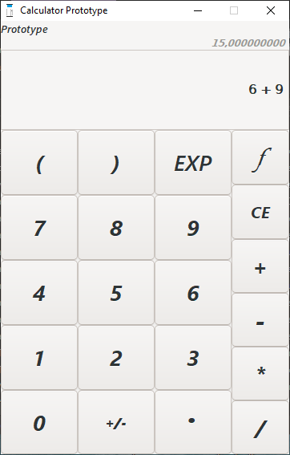

# C Numerical Projects

A small collection of C projects built around a shared mathematical expression evaluator. The repository contains a GTK calculator and two command-line numerical-method tools.



## Projects

### NormalCalculator

A GTK 3 scientific calculator for Windows. It evaluates expressions containing arithmetic operators, parentheses, powers, and mathematical functions. Angles are interpreted in degrees.

Supported operations include:

- Arithmetic: `+`, `-`, `*`, `/`, `^`
- Implicit multiplication with `&`, for example `2 ( 3 + 4 )`
- Trigonometric, inverse trigonometric, hyperbolic, and inverse hyperbolic functions
- `ln`, `log`, `sqrt`, `cbrt` and `EXP`
- Live result updates, a two-page keypad, expression clearing, and scientific notation for very large or small results

The GUI is defined in `Interface.c` and the original Glade file is included for reference. The calculator was developed with Dev-C++ and MSYS2 using GTK 3.

Known limitation: floating point numbers aren't recognized by the calculator, although the decimal point button works.

### SolutionToFunctions

A command-line program that approximates real roots of a function within an interval. It uses the Newton-Raphson method with numerical differentiation.

The program scans the interval from 53 starting points, iterates up to 2,000 times per starting point, and filters duplicate roots with a tolerance of `0.0001`. The input expression uses the same syntax and degree-based angles as `NormalCalculator`.

Newton-Raphson is a local method, so roots can be missed when the derivative is near zero, the function oscillates rapidly, or no starting point is sufficiently close to a root.

### IntegrationWithLimits

A command-line program that approximates a definite integral using the composite Simpson's 1/3 rule.

The interval is divided into 60,000 sub-intervals. The integrand is entered as an expression containing `X`, and the program substitutes each sample value before evaluating it with the shared calculator engine. Type `EXIT` at the function prompt to quit.

Example:

```text
Enter a function:
X ^ 2
Enter the limits (lower then higher):
0 3
The result is : 9.0000
```

The method is numerical only. The step count is fixed, singularities are not detected reliably, and angles are interpreted in degrees.

## Repository layout

```text
C-Numerical-Projects/
├── NormalCalculator/
│   ├── assets/
│   │   ├── CALCULATOR_PROTOTYPE_INTERFACE.PNG
│   │   ├── CalculatorIcon.ico
│   │   └── CalculatorIcon.png
│   ├── Interface.c
│   ├── NormalCalculator.dev
│   ├── NormalCalculator.layout
│   ├── NormalCalculator.rc
│   └── NormalCalculatorInterface.glade
├── SolutionToFunctions/
│   ├── SolutionToFunctions.c
│   ├── SolutionToFunctions.dev
│   └── SolutionToFunctions.layout
├── IntegrationWithLimits/
│   ├── IntegrationWithLimits.c
│   ├── IntegrationWithLimits.dev
│   └── IntegrationWithLimits.layout
├── shared/
│   ├── Cal.c
│   └── Cal.h
└── README.md
```

`Cal.c` and `Cal.h` are kept in `shared/` because all three applications use the same expression engine. The source files retain their original `#include "Cal.h"` statements; add `shared/` to the compiler include path when building from a project directory.

## Expression engine

The shared evaluator works in stages:

1. Validate parentheses.
2. Extract innermost parenthesized expressions.
3. Tokenize values, signs, and functions.
4. Apply functions and evaluate operators in precedence order.
5. Substitute solved expressions until the complete result is available.

It supports arithmetic, powers, roots, logarithms, trigonometric functions, hyperbolic functions, and degree-based angles.

## Requirements

- A C compiler such as GCC or Clang
- The math library (`-lm` on Linux and MSYS2)
- GTK 3.24 for `NormalCalculator`
- `pkg-config` for obtaining GTK compiler and linker flags

## Build

### Console projects

From the repository root, build either console program with GCC:

```bash
gcc -Ishared shared/Cal.c SolutionToFunctions/SolutionToFunctions.c -lm -o SolutionToFunctions/SolutionToFunctions
gcc -Ishared shared/Cal.c IntegrationWithLimits/IntegrationWithLimits.c -lm -o IntegrationWithLimits/IntegrationWithLimits
```

### GTK calculator

From the repository root, obtain GTK flags with:

```bash
pkg-config --cflags gtk+-3.0
pkg-config --libs gtk+-3.0
```

Then compile with GCC, using the returned flags and the shared source:

```bash
gcc -Ishared $(pkg-config --cflags gtk+-3.0) shared/Cal.c NormalCalculator/Interface.c $(pkg-config --libs gtk+-3.0) -o NormalCalculator/NormalCalculator
```

On Windows, the original project was built with MSYS2 UCRT64 and Dev-C++.

## Project history

These projects were developed iteratively as a learning exercise in C, expression parsing, GUI programming, and numerical methods. `NormalCalculator` provides the shared evaluation engine; the other two programs build numerical algorithms on top of it.

## License

This repository is provided for educational purposes. Feel free to study, fork, and extend it.
